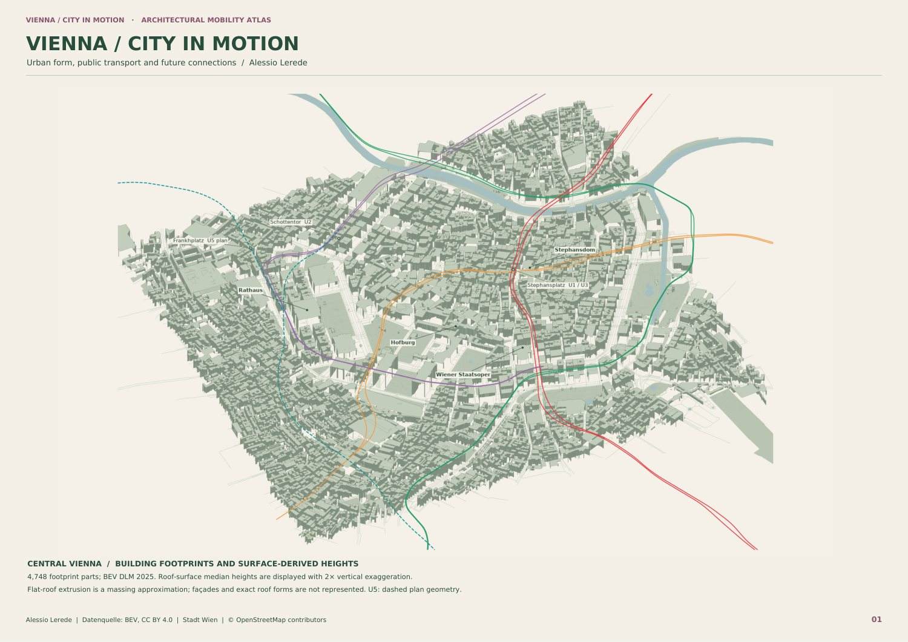

# Vienna / City in Motion

**Vienna Urban Mobility Lab** · Alessio Lerede

An 18-page architectural research and scenario-design atlas of Vienna's urban form, public transport, official U2/U5 planning and three exploratory tangential corridors.

[Read the complete atlas](VIENNA_URBAN_MOBILITY_ATLAS_FINAL.pdf) · [Open the curated QGIS project](VIENNA_MOBILITY_GITHUB.qgz) · [Methods and limitations](docs/METHODS.md) · [Data sources and licences](docs/DATA_LICENCES.md)

## What this study does — and does not — show

The City of Vienna's planning GIS is distinct from operating infrastructure. The West Arc, North Danube and South Arc are exploratory road paths, **not** official transport plans or engineered alignments. No walking catchments, population coverage, journey-time savings, passenger demand or equity effects have been validated. The GHSL 2025 layer is a projection, not an official resident count. See the PDF and methods for the full limitations.

The new axonometrics use BEV 2025 footprint objects with surface-derived median object heights. Flat roof planes and façades are simplified, the base is flat and vertical heights are displayed at 2×. The North Danube study uses the existing North Danube building-footprint layer as its area; six parts with missing or nonpositive heights were omitted. The Copernicus 30 m inset is a surface model, not bare-earth terrain.

## Repository

- `VIENNA_URBAN_MOBILITY_ATLAS_FINAL.pdf` — 18-page atlas; 58.7 MiB (GitHub may warn above 50 MiB).
- `VIENNA_MOBILITY_GITHUB.qgz` — curated, relative-path QGIS project with 20 layers; open with QGIS 4.2.3 or compatible. It is not the complete V3–V9 project and does not contain the PDF's original layouts.
- `data/` — referenced City, BEV, OSM/Overture and population QA extracts, plus conceptual paths and the local road-routing input.
- `scripts/reproduce_routes.py` — independent route-length check in QGIS Python; requires NetworkX and SciPy.
- `docs/` — source and licence inventory, methods and release checklist.
- `SHA256SUMS.txt` — checksums for the other repository files.

All individual files are below GitHub's 100 MB limit. The OSM-tagged building input is split into two GeoPackages by original feature ID (122,478 + 128,735 = 251,213 features), each under 50 MiB. Keep both parts. The data folder is about 213 MiB; do not omit ODbL material merely to make the repository smaller.

## Reproduce the route check

In the QGIS Python console editor, open `scripts/reproduce_routes.py`, set `REPO` to the repository root if `__file__` is not defined, and run it in a QGIS Python environment with NetworkX and SciPy. Verified against the copied files on 22 November 2026: West 12,250.245 m, North 7,950.261 m, South 10,592.420 m; differences from stored lengths below 0.01 m. The check verifies calculations only, not a pedestrian or transit network.

The project's 20 layers were reopened successfully locally and its saved layer paths are relative. Moving it to a separate machine has not been tested. The atlas and 3D-production pipeline are **not fully reproducible** from this folder: the GHSL source raster, complete original layouts, and full graphics-generation script are not included. See the methods for how to obtain omitted sources.

## Rights and release status

Map data © OpenStreetMap contributors, ODbL 1.0; Overture Maps Foundation, transportation includes TomTom data. City datasets: Datenquelle Stadt Wien, CC BY 4.0. Building heights: Datenquelle BEV, CC BY 4.0. GHSL: European Commission JRC, CC BY 4.0. Full notices and links are in [data licences](docs/DATA_LICENCES.md) and the atlas.

This release archive was prepared locally. Once the repository is published, the machine-readable extracts are available in [`data/`](data/), with provenance in [`docs/SOURCE_AUDIT_2026_11_22.md`](docs/SOURCE_AUDIT_2026_11_22.md). Verify that every required ODbL source, derivative database or permitted alternative is available under its applicable terms; publicly distributing the files alone is **not independent legal clearance**. Provide the public repository URL whenever sharing the PDF. The PDF's page-18 status describes the files **at assembly time**, before online publication. No blanket licence is granted over the author's original text and design; third-party data keep their own licences.
